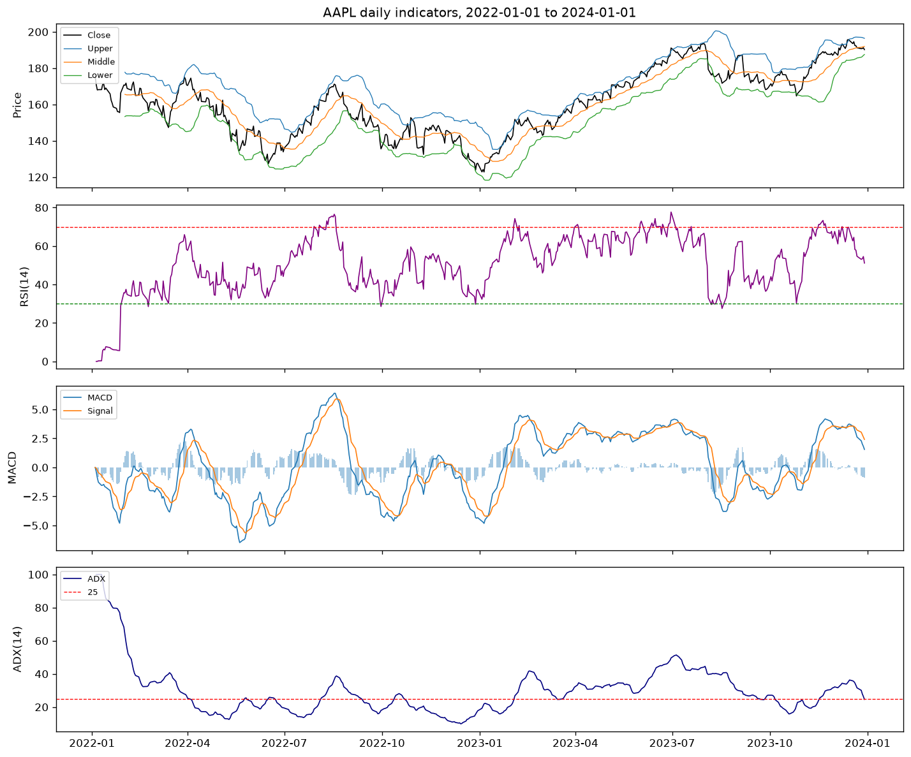
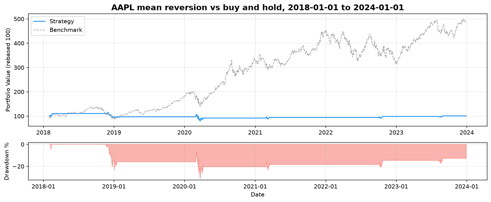
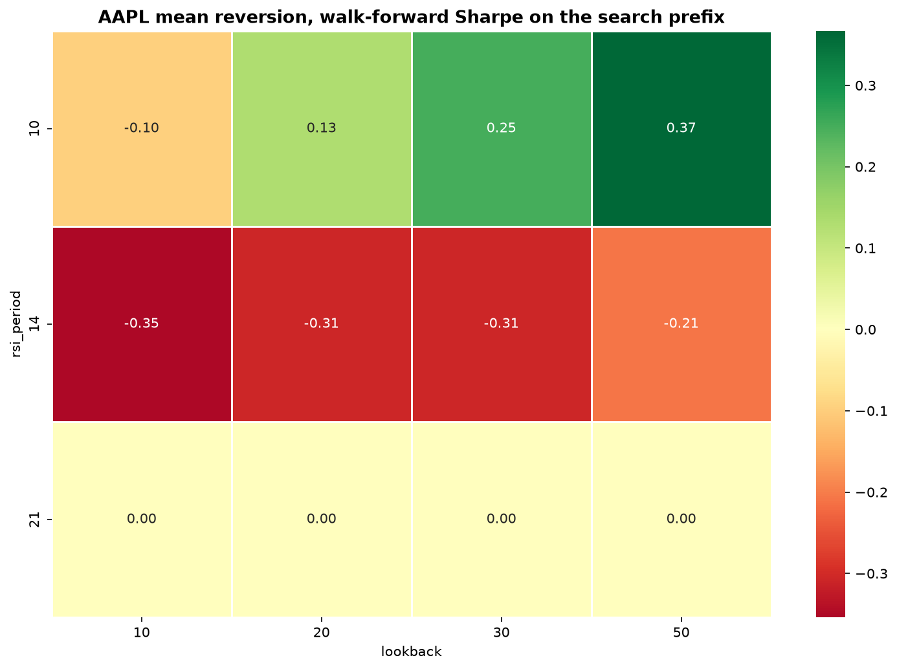

# Algorithmic trading research

Code for three systematic strategies: mean reversion, momentum, and a pairs spread. It builds signals, backtests one asset with next-bar fills and one-way costs, searches parameters on a walk-forward prefix, and can replay a strategy through an in-memory paper broker.

The paper broker is the default. Alpaca and CCXT stay on paper or sandbox endpoints unless you pass `--allow-live`. API keys are read from the environment, not from the sample config.

## What is implemented

- **Data.** Yahoo Finance OHLCV. Results are cached under `data/cache/` when pyarrow or fastparquet is installed. Optional Alpaca and CCXT fetchers.
- **Indicators.** RSI, MACD, Bollinger Bands, ATR, ADX, OBV, and the other functions in `src/indicators.py`.
- **Strategies.** Mean reversion (RSI and Bollinger Bands), momentum (MACD cross, only when ADX is above a threshold), and a pairs spread (rolling hedge ratio and z-score).
- **Backtest.** A signal on bar *t* is filled at the close of bar *t+1*. It does not earn the return that starts at its own close. Commission and slippage are charged on absolute turnover. The pairs strategy returns two legs. The vectorized backtest prices one series, so it does not mark a long/short pair book.
- **Search.** Grid, random, or Bayesian search. Parameters are chosen on walk-forward folds of a prefix. The tail is scored once and is not used to pick parameters. Random and Bayesian draws use a fixed seed.
- **Risk.** Notional caps, ATR sizing, stops, and a drawdown halt that stays flat.
- **Execution.** In-memory paper broker. Alpaca paper and CCXT sandbox are optional.

## Run

Requires Python 3.11 (CI) or 3.12. The scientific packages, hyperopt, matplotlib, and pytest are pinned in `requirements.txt`. Broker and notebook packages are not, and CI does not install them.

```bash
python -m venv .venv
source .venv/bin/activate
pip install -r requirements.txt
pytest
```

Copy `.env.example` if you point a fetcher at Alpaca or CCXT. Leave the keys empty for the paper broker. `config/example.yaml` has no secrets and defaults to `broker: paper`.

```bash
python src/run_bot.py --strategy mean_reversion --ticker AAPL
python src/run_bot.py --strategy momentum --ticker BTC-USD --start 2021-01-01
python src/run_bot.py --config config/example.yaml
```

`--config` uses the file's bar interval and the strategy keys that the selected strategy accepts. Other keys under `strategy.params` are ignored.

`--live` walks historical bars. It still uses the paper broker unless you change `--broker`. Alpaca's live endpoint and a CCXT route outside the sandbox also need `--allow-live`.

The notebooks walk through indicators, a single-asset backtest, a parameter search (including the holdout score), and the paper loop.

## Figures

`screenshots/` is the output of `python scripts/make_figures.py`. Strategy charts use Yahoo Finance daily bars from 2018-01-01 through 2024-01-01. The indicator chart starts at 2022-01-01. Costs are the sample config: $100,000, 10 bps commission, 5 bps slippage. The optimization heatmap is the walk-forward score on the search prefix, not the holdout. The paper chart is the in-memory broker, not a live account.







The other files in that directory are the mean-reversion signals, the QQQ momentum equity curve, the AAPL/MSFT spread z-score, and the paper-broker equity. On this window, buy and hold finishes ahead of the default mean-reversion and momentum settings. Re-run the script to regenerate the files. Yahoo's adjusted prices can change, so a later run can differ slightly.

## Limits

This is research code. A backtest is not a forecast. The paper broker does not model borrowing, partial fills, or outages.
